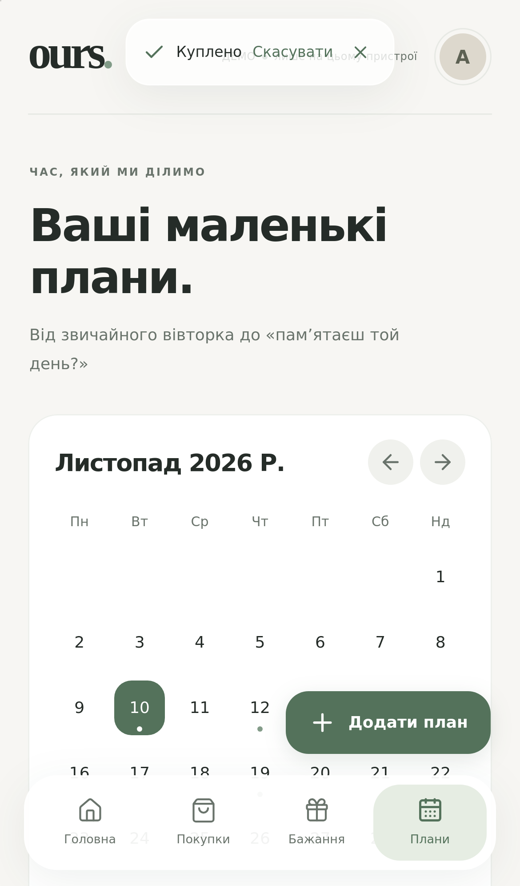

# ours. — вигляд застосунку

Справжні скриншоти браузерних перевірок GitHub Actions: WebKit з емуляцією iPhone 13. На знімках — лише позначені демодані. Це не фото фізичного iPhone; системна клавіатура та встановлення PWA потребують окремої перевірки на пристрої.

## Головна

## Бажання

## Плани

## Темна тема

