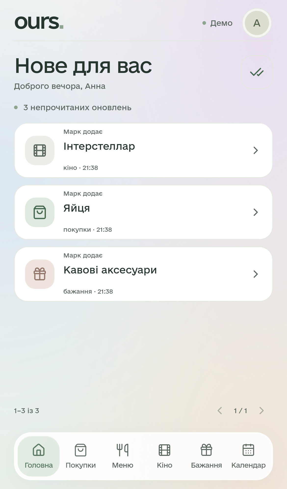
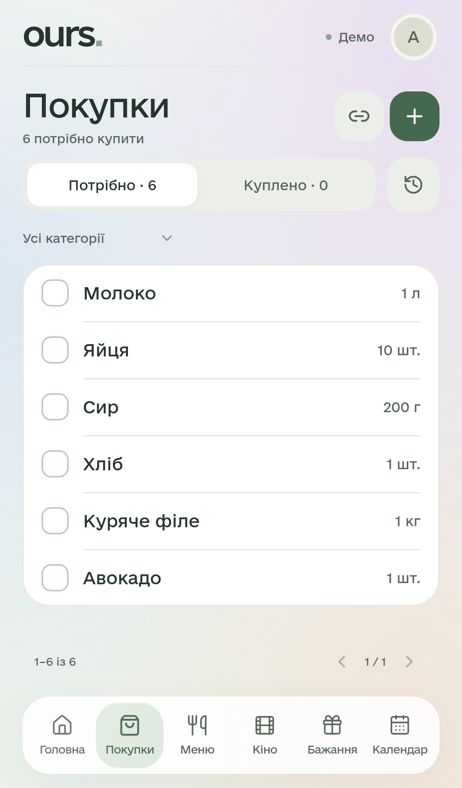
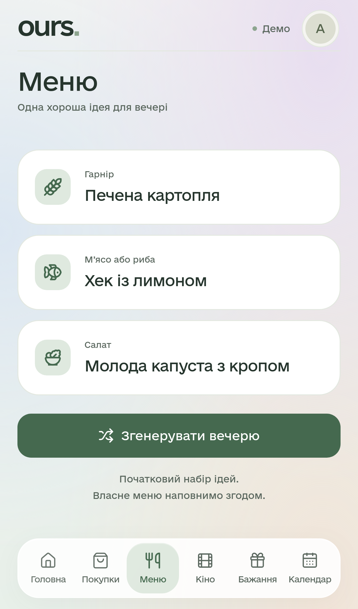
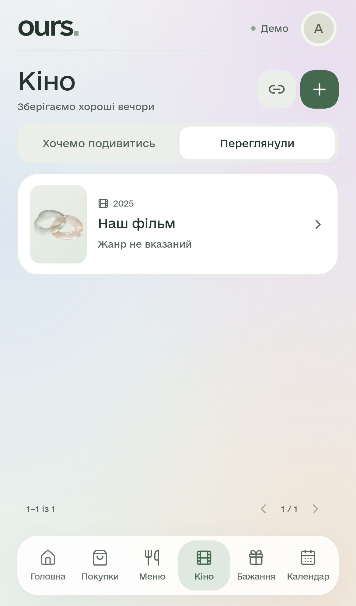
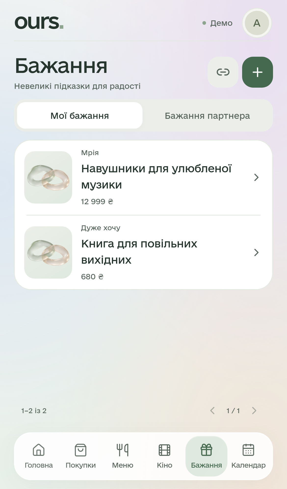
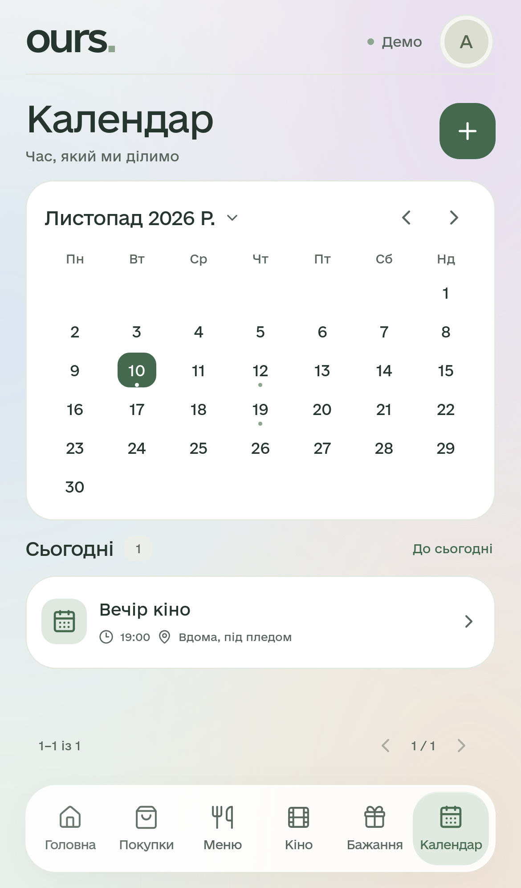
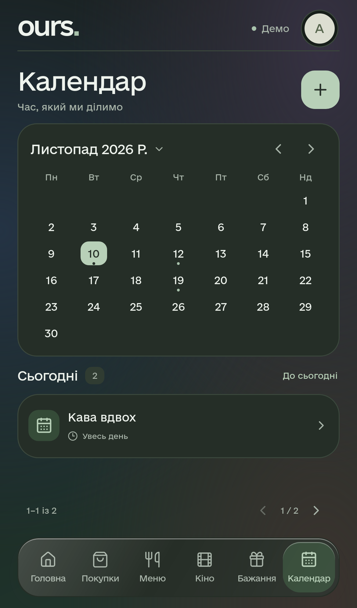
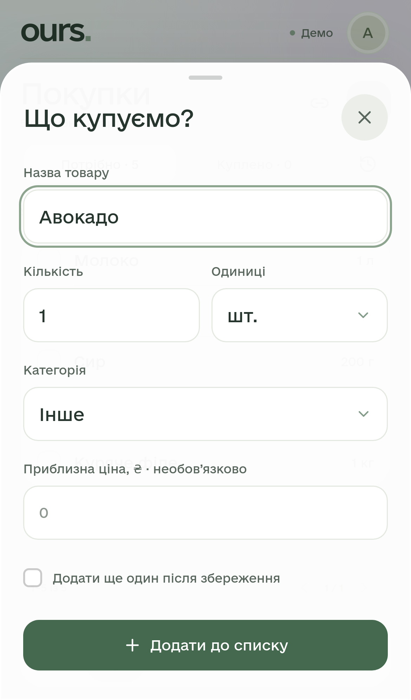
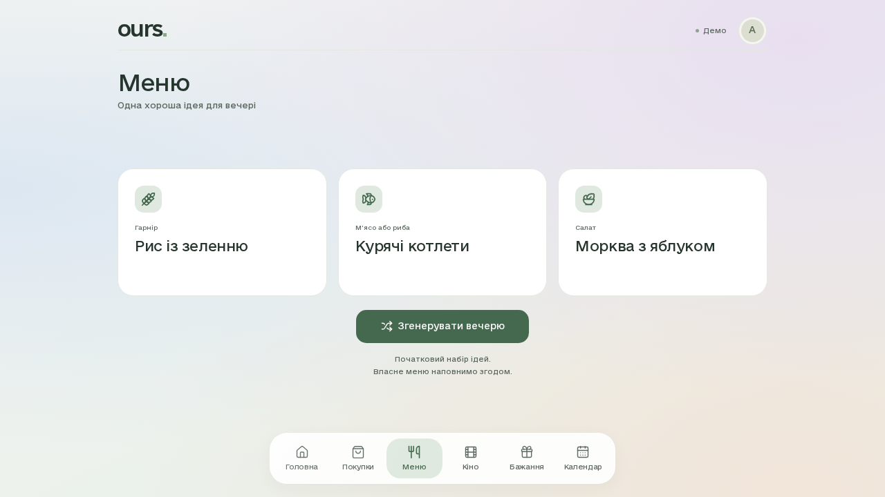

# ours. 2 — вигляд застосунку

Справжні скриншоти [успішного браузерного прогону](https://github.com/hubaluna/ours/actions/runs/42886950139), код `4c0e7de`. WebKit з емуляцією iPhone 13, viewport 390×664 CSS px. На знімках — позначені демодані. Це не фото фізичного iPhone; системна клавіатура та встановлення PWA потребують окремої перевірки на пристрої.

## Головна — тільки нове

## Покупки

## Меню — ідея для вечері

## Кіно

## Бажання

## Календар

## Темна тема

## Розгорнута форма

## Меню на десктопі

